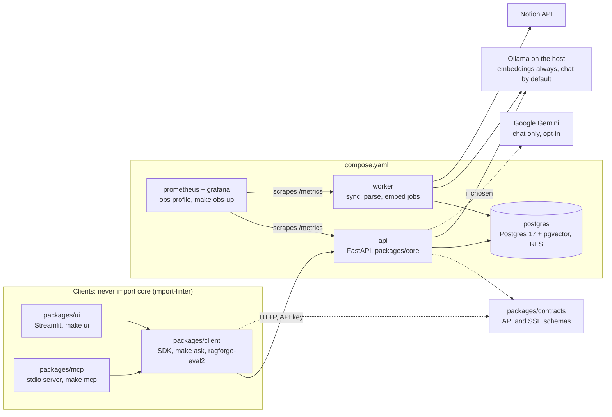

# RAGForge

Ask questions about your Notion pages or uploaded files and get answers whose citations are checked against the source. A citation from Notion links to the exact block.
It runs on your machine with Docker and is used through a web UI, a terminal chat, a REST API, or Claude Code over MCP.

<!-- TODO(owner, optional): a screenshot of a verified answer on the Acme demo tenant goes here. -->

## Three guarantees, and the tests that hold them

**1. Citations are checked against the source, and Notion citations deep-link to the block.**
Every answer carries a status: `verified`, `partial`, `unsupported` or `unverified` ([api.py](packages/contracts/src/ragforge_contracts/api.py), `VerificationStatus`).
An answer is `verified` only when the ground check agrees and every part of it is covered by a citation to a source shown this turn, apart from a small closed allowlist of non-claim text.
- Code: [citations.py](packages/core/src/ragforge_core/agent/citations.py) (a label must name evidence shown this turn), [grounding.py](packages/core/src/ragforge_core/agent/grounding.py) (the model-based ground check), [coverage.py](packages/core/src/ragforge_core/agent/coverage.py) (what is left uncovered blocks `verified`), [normalize.py](packages/core/src/ragforge_core/adapters/connectors/notion/normalize.py) (Notion block anchors).
- Tests: [test_ag_coverage.py](packages/core/tests/module_ag/test_ag_coverage.py) `test_review_attacks` (answers that blind reviewers wrote to fool the check), [test_ag_attribution.py](packages/core/tests/module_ag/test_ag_attribution.py) `test_a_negation_the_source_lacks_gets_no_source`, [test_c1_normalize.py](packages/core/tests/module_c1/test_c1_normalize.py) `test_anchors_are_dashless_block_ids_and_deep_links_land_on_the_block`, [test_ui_render.py](packages/core/tests/module_ui/test_ui_render.py) `test_citation_chip_uses_the_answer_label_and_links_the_paragraph`.
- Not covered: word overlap is not proof of meaning. Contradictions and recombined facts are left to the ground check, which is a model and can miss ([ADR-0015](docs/adr/0015-retrieve-then-answer.md)). Uploaded files are cited by title with no link ([parser.py](packages/core/src/ragforge_core/adapters/connectors/files/parser.py) sets `external_url=None`).

**2. Tenants are isolated by Postgres row-level security.**
Every tenant table gets the `tenant_isolation` policy ([helpers.py](packages/core/src/ragforge_core/db/migrations/helpers.py), `tenant_table`). The app's runtime login roles, `rf_api` and `rf_worker`, are never members of the owner role, so the policy always filters them ([ADR-0013](docs/adr/0013-db-roles-and-tenancy-model.md)).
- Tests (need Docker): [test_db_foundation.py](packages/core/tests/test_db_foundation.py) `test_rls_isolates_tenants`, `test_rls_fails_closed_without_tenant`, `test_tenant_tables_have_rls_enabled_not_forced`; [test_e2_api_isolation.py](packages/core/tests/module_e2/test_e2_api_isolation.py) `test_every_endpoint_answers_404_for_another_tenants_ids`, `test_lists_never_show_another_tenants_rows`.
- Not covered: RLS is enabled, not forced. The owner role `rf_system` sees all tenants, so it cannot log in. Two other login roles see all tenants by design ([ADR-0013](docs/adr/0013-db-roles-and-tenancy-model.md)): `rf_migrator` acts as `rf_system` through `SET ROLE`, and the read-only `rf_backup` reads every tenant for `pg_dump`. Tests: [test_db_foundation.py](packages/core/tests/test_db_foundation.py) `test_rf_system_cannot_log_in`, `test_backup_role_reads_all_tenants`.

**3. Local first.**
Embeddings and the search index always stay on your machine (Ollama and Postgres with pgvector). The chat model is local Ollama by default, or Google Gemini if you choose it.
- Code: [embedder_ollama.py](packages/core/src/ragforge_core/adapters/llm/embedder_ollama.py) (the only embedder), [provider.py](packages/core/src/ragforge_core/adapters/llm/provider.py) (picks the chat model; the default is `ollama` in [config.py](packages/core/src/ragforge_core/config.py)), [egress_guard.py](packages/core/tests/egress_guard.py) (a pytest plugin, on for every test run, that fails a test reaching any host but this machine).
- Tests: [test_sec_threat_egress_inventory.py](packages/core/tests/test_sec_threat_egress_inventory.py) `test_outbound_hosts_match_the_inventory_exactly`, `test_runtime_egress_is_exactly_notion_and_gemini`; [test_sec_threat_egress_guard.py](packages/core/tests/test_sec_threat_egress_guard.py) `test_non_loopback_connect_is_refused_before_any_packet`; [test_sec_threat_no_silent_egress.py](packages/core/tests/test_sec_threat_no_silent_egress.py) `test_reranker_never_downloads_by_default`, `test_compose_services_get_no_tracing_or_proxy_env`.
- Not covered: on Gemini, each question and the note snippets retrieved for it go to Google ([GUIDE](docs/GUIDE.md) explains the trade-off). Through MCP, the answers and snippets go to your MCP client's model provider ([SECURITY.md](docs/SECURITY.md#35-egress-data-leaves-the-machine), trust boundary B6). The guard patches Python's `socket` module only; its docstring lists what it cannot see.

Check it without Docker: `make test-unit` (the isolation tests under guarantee 2 need Docker: `make test`).

## Why it is built this way

- **One datastore.** Postgres holds documents, vectors (pgvector), jobs and audit: one backup, one transaction boundary, no broker ([ADR-0002](docs/adr/0002-postgres-as-single-datastore.md), [ADR-0003](docs/adr/0003-no-outbox-or-broker-in-v1.md)).
- **Isolation in the database.** Tenancy is enforced by RLS and per-role grants, so a query that forgets its tenant filter still sees only its own tenant's rows (the roles that see all tenants are listed under guarantee 2) ([ADR-0013](docs/adr/0013-db-roles-and-tenancy-model.md)).
- **Retrieve, then answer.** The model answers only from retrieved, fenced notes, and an answer is marked `verified` only when its citations cover it and a model ground check against those notes passes ([ADR-0015](docs/adr/0015-retrieve-then-answer.md), [ADR-0011](docs/adr/0011-streaming-verification-and-output-safety.md)).
- **MCP is a thin API client.** Claude Code goes through the same API, keys and scopes as the UI; it can never approve its own actions ([ADR-0005](docs/adr/0005-mcp-as-thin-api-client.md)).
- **Measured, not asserted.** Its own eval layer with confidence intervals, a regression gate and planted-error tests for the verifier ([ADR-0017](docs/adr/0017-eval-layer.md)). It is used daily by its owner on their own Notion notes.

## Architecture



One-shot services also run at start-up: `db-bootstrap` (roles and schemas), `migrate` (Alembic) and `index` (a best-effort vector index build). On Linux, Ollama runs as a container (the `ollama` profile). The tested platform is macOS on Apple silicon with Rancher Desktop.

## Quickstart

You need Docker, [uv](https://docs.astral.sh/uv/), python3 and openssl; on macOS also Ollama on the host (on Linux it runs in a container). The [GUIDE](docs/GUIDE.md) covers each step, what you should see, and what to do if it fails.

Once after cloning, run `make sync`. It installs the UI and MCP packages, which a plain `uv run` does not install, so `make ui` and the MCP server need it ([GUIDE](docs/GUIDE.md#install-the-python-tools-once)).

```bash
make doctor          # checks this machine: RAM, disk, Docker, ports, uv, Ollama, the chosen provider
make up              # builds and starts the stack; the first run in a terminal asks: Ollama or Gemini
make models          # pulls the embedding model and the Ollama chat model into Ollama
make tenant          # creates your tenant; the owner key goes to a 0600 file and is never printed
make connect-notion  # connects Notion; the integration token is read as hidden input
make ui              # web UI on http://localhost:8501 (or make ask, to chat in the terminal)
```

- Run `make models` on both paths: embeddings are always local. On Gemini it also pulls an Ollama chat model that is not used.
- Before `make connect-notion`, create a Notion internal integration and share your pages with it ([GUIDE](docs/GUIDE.md)).
- To switch provider later, run `make setup`, then `make up`.
- For Claude Code, `make mcp-key` creates a separate MCP key and `make mcp-install` prints the command to register the server.

## Results

The full tables, with what each metric means and how each interval is computed, are in [RESULTS.md](docs/RESULTS.md); the numbers there are generated from the run summaries, not typed.

<!-- generated:readme-headline run_ids=application-demo-20261021T174004Z digests=6d992b2721a2d8a87e4bb613e33327f1902d514a6e83eac6318d5c337d72369d -->
**Full chat path, Acme demo set (20 questions, 7 not answerable from the pages).** Provider: Google Gemini. Model: gemini-3.5-flash-lite. Dataset: demo (set `demo`, split dev). n = 20. Run date (UTC): 2026-10-21.

| Metric | Value | 95% CI | n | Method | Note |
|---|---|---|---|---|---|
| correct: answered from an expected page with at least 2/3 of the expected facts, or abstained when it should | 0.900 | [0.699, 0.972] | 20 | Wilson |  |
| verified badge (a server-written abstain counts as verified) | 0.900 | [0.699, 0.972] | 20 | Wilson |  |
| abstained exactly when the pages had no answer | 1.000 | [0.839, 1.000] | 20 | Wilson |  |
<!-- /generated -->

<!-- generated:readme-private run_ids=generator-A-20261022T071117Z digests=d8cfb881a65f5883543c16c566befe3e78e5f8632358600adfc2ee1b1b021472 -->
**Answers on the owner's real notes (32 questions; numbers only, the set is private).** Provider: Google Gemini. Model: gemini-3.5-flash-lite. Dataset: private (set `private`, split dev). n = 32. Run date (UTC): 2026-10-22.

| Metric | Value | 95% CI | n | Method | Note |
|---|---|---|---|---|---|
| correct | 0.969 | [0.843, 0.994] | 32 | Wilson |  |
| verified badge | 0.781 | [0.612, 0.890] | 32 | Wilson |  |
| abstained exactly when the notes had no answer | 1.000 | [0.893, 1.000] | 32 | Wilson |  |
<!-- /generated -->

<!-- generated:readme-verifier run_ids=verifier-demo-20261021T174717Z digests=9da010a4b144a6fa3870e81d40152c6470394c2cd2c6c046e54119dab15e9508 -->
**Verifier on planted errors, Acme demo set (the measure of guarantee 1).** Provider: Google Gemini. Model: gemini-3.5-flash-lite. Dataset: demo (set `demo`, split dev). n = 11. Run date (UTC): 2026-10-21.

| Metric | Value | 95% CI | n | Method | Note |
|---|---|---|---|---|---|
| badge-flip recall: a planted wrong fact took the answer off verified | 0.909 | [0.587, 1.000] | 11 | cluster bootstrap | on 7 clean-verified sources; a bound widened to the exact Clopper-Pearson bound |
<!-- /generated -->

In both `verified` rows a server-written abstain counts as verified; badge-flip recall is the direct test of the citation and ground checks. The grade is in [runners.py](packages/client/src/ragforge_client/evals/runners.py) (`answer_grades`) and the metrics in [metrics.py](packages/client/src/ragforge_client/evals/metrics.py). Numbers on local Ollama will differ. The table is generated from the run's summary file, and a test fails if it drifts.

## Limits

- **Small samples, one labeller.** n is 20 or fewer on the demo set (see the n column in [RESULTS](docs/RESULTS.md)). Rows that need the owner's labels (on the private set: the verifier's badge-flip recall, span recall and false reject; the judge's calibration) are pending ([RESULTS](docs/RESULTS.md)), and the held-out set is not sealed yet ([DECISIONS](docs/DECISIONS.md)).
- **Gemini numbers only.** Every answer number above was measured on Gemini Flash-Lite; no local Ollama chat run is measured yet, although Ollama is the default.
- **Latency.** The hosted 5 s latency target from DESIGN §2 is not met today ([ADR-0018](docs/adr/0018-ops-hardening-security-observability.md), [RESULTS](docs/RESULTS.md)).
- **Parked work.** CI is written ([.github/workflows/ci.yml](.github/workflows/ci.yml): lint, types, tests, image build, Trivy, a smoke test) but has never run; its first run is the first push. No Helm or kind, no load test, and no database backup: `make nuke` deletes every data volume, and `make backup-evals` copies only the eval data ([DECISIONS](docs/DECISIONS.md)).

## Documentation

| Document | What it holds |
|---|---|
| [GUIDE.md](docs/GUIDE.md) | Step-by-step use: providers and privacy, Notion, files, asking, MCP, badges, interview mode, evals, observability, backups, troubleshooting |
| [RESULTS.md](docs/RESULTS.md) | Measured results, generated from run summaries, with their limits |
| [DECISIONS.md](docs/DECISIONS.md) | One row per ADR, the review history, parked work and known open issues |
| [DESIGN.md](docs/DESIGN.md) | The design as of Phase 0; later changes are in the ADRs |
| [SECURITY.md](docs/SECURITY.md) | Threat model, accepted risks and rotation runbooks, updated through Phase 4 |
| [docs/adr/](docs/adr/) | Architecture decision records 0001 to 0018 |
| [REVIEW.md](docs/REVIEW.md) | Every design and code review round, in order, with the scores |
| [NEXT.md](docs/NEXT.md) | The working log and plan; [RESULTS.md](docs/RESULTS.md) is the source of truth for numbers |

## Development

```bash
make sync        # installs every workspace package and extra
make check       # ruff, mypy --strict, import-linter, all tests (integration tests need Docker)
make test-unit   # tests that do not need Docker
```

```text
packages/contracts   API and SSE schemas (pydantic only)
packages/core        domain, services, rag, agent, adapters, apps (api, worker, migrate), db
packages/client      typed SDK, make ask, the eval CLI (never imports core)
packages/mcp         MCP server over stdio, a thin API client (ADR-0005)
packages/ui          Streamlit UI
```
